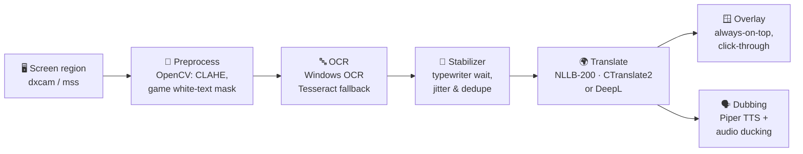

# Afu Dublaj

**Play any game. Watch any video. In your language — in real time, fully offline.**

Afu Dublaj reads the subtitles on your screen, translates them with Meta's NLLB‑200 neural model running *on your own PC*, 
shows the translation in a floating overlay — and can even **dub it out loud** with a natural neural voice.

[**⬇ Download for Windows**](https://github.com/pirncedark/AfuDublaj/releases/latest) · [Quick start](#-quick-start) · [How it works](#-how-it-works)

---

## 🚀 Kurulum ve Otomatik Güncelleme / Quick Start

**Afu Dublaj**'yu kullanmak için [GitHub Releases](https://github.com/pirncedark/AfuDublaj/releases/latest) sayfasından `AfuDublaj-*-windows-x64.zip` arşivini indirip dilediğiniz bir klasöre çıkartın ve `AfuDublaj.exe` dosyasını çalıştırın; uygulama ilk açılışta çeviri modelini tek seferlik indirerek tamamen çevrimdışı çalışmaya hazır hale gelir ve yeni bir sürüm çıktığında dahili otomatik güncelleme sistemi sayesinde SHA-256 doğrulamasını yaparak kendini tek tıkla arka planda günceller (veya kaynak koddan çalıştırmak için `pip install -e ".[all]"` ardından `python -m lingolay` komutunu kullanabilirsiniz).

---

## ✨ Highlights

| | |
|---|---|
| 🔒 **100 % offline & private** | Translation runs locally with [NLLB‑200](https://ai.meta.com/research/no-language-left-behind/) via CTranslate2. No account, no API key, no telemetry — nothing leaves your PC. |
| 🌍 **21 languages, any direction** | English, Japanese, Chinese, Korean, Russian, German, French, Spanish, Portuguese, Italian, Dutch, Polish, Ukrainian, Arabic, Turkish, **Hindi, Urdu, Bengali, Vietnamese, Indonesian, Thai**. Pick *on‑screen* → *target* freely. |
| 🎮 **Built for games** | Game mode (auto‑borderless), click‑through always‑on‑top overlay, global hotkeys that work in‑game, white‑text subtitle isolation. |
| 🗣️ **Neural voice dubbing** | Hear translations read aloud with [Piper](https://github.com/rhasspy/piper) voices — also offline — while other apps are automatically ducked. Available for every target language except Thai (for now). |
| 🎭 **Speaker‑aware dubbing** *(experimental)* | Afu Dublaj listens to the game or video, hears whether a **man or a woman** is speaking and dubs each line with a **matching voice**, in all 20 dubbed languages. Fully offline, and Afu Dublaj's own voice is never picked up. Turn it on under *Voice dubbing → Match the speaker's voice* (Windows 10 2004+). |
| 🔎 **Translate screen** *(experimental)* | Press `Ctrl+Alt+T`: every text on the screen is translated **right where it is**, drawn over the original with its colors, outline and size, so menus, notes and HUDs read as if the game were in your language. Press again to hide. |
| 🧠 **Smart subtitle handling** | Waits for typewriter‑style subtitles to finish, ignores OCR flicker, never re‑translates a line it already showed, and never reads its own overlay. |
| ⚡ **Fast** | ~150–250 ms per sentence on a regular CPU, faster with an NVIDIA GPU. Adaptive capture rate keeps CPU usage low. |
| 🧩 **Optional DeepL** | Bring your own free DeepL API key for maximum quality with zero GPU load. |
| 🎨 **Fully customizable** | Font, size, colors, outline or box, width, position, per‑game capture profiles, rebindable hotkeys. Turkish, German, Russian & English UI. |

## 🎯 Tips for the best results

- **Games:** run them in *Windowed* or *Borderless* mode (exclusive fullscreen can't be captured), then use **🎮 Game mode** — it applies a white‑text subtitle filter and hides the main window (`Ctrl+Alt+W` brings it back).
- **Movies & series:** select only the subtitle strip at the bottom — a smaller region is faster and more accurate.
- **Calibrate** with **OCR preview**: it shows the raw recognized text without translating.
- **Save a profile** per game/platform so you never have to select the region again.
- **Windows OCR language packs:** to read Japanese, Chinese, Korean, … install that language in *Settings → Time & Language → Language* (with *Optical character recognition*).

## ⌨️ Default shortcuts

| Action | Shortcut | Action | Shortcut |
|---|---|---|---|
| Start / Stop | `Ctrl+Alt+S` | OCR preview | `Ctrl+Alt+P` |
| Select region | `Ctrl+Alt+R` | Show/hide window | `Ctrl+Alt+W` |
| Show/hide overlay | `Ctrl+Alt+O` | Game mode | `Ctrl+Alt+G` |
| Dubbing on/off | `Ctrl+Alt+D` | Translate screen | `Ctrl+Alt+T` |

All shortcuts can be rebound in the app.

## 🧠 How it works

- A capture thread grabs only your region; if the picture hasn't changed, OCR is skipped entirely.
- The stabilizer learns whether a source shows subtitles *all at once* or *letter by letter*, and waits just long enough.
- Sentences already translated are dropped from scrolling subtitles, so each line is translated (and spoken) exactly once.

## 📜 License

Afu Dublaj is free software licensed under the [GNU General Public License v3.0](LICENSE).

Models are downloaded directly from their respective upstream sources (Meta AI NLLB-200, Piper voices).
